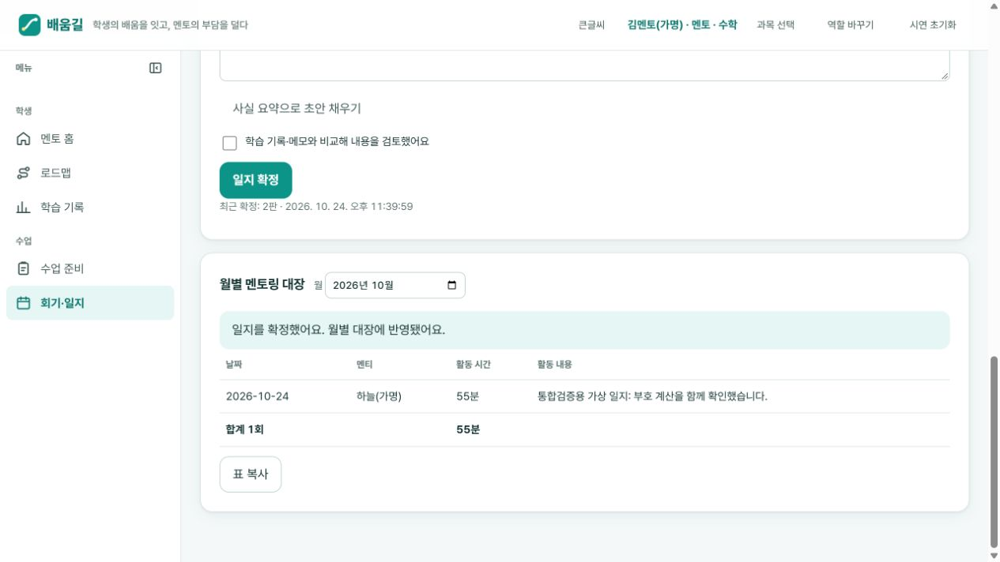

# 기능 점검 오류 6건 수정 및 통합 검증

- 대상: `ver2`, 기준 커밋 `c0b1b3a` 위 작업 변경분
- 검증일: 2026-10-24
- 범위: 리뷰에서 확인한 오류 6건. 화면 간소화·메뉴 재구성은 변경하지 않음.
- 작업 시작과 종료 시 다른 Codex 작업의 유휴 상태 및 작업 트리 확인. 다른 세션 변경과의 충돌 없음.

## 수정 결과

| 오류 | 수정 | 기록 보존 확인 |
|---|---|---|
| 멘토가 이전 단계로 되돌리면 새 답안이 중복 제출로 무시됨 | 단계 진입 이력으로 새 문항 인스턴스 ID를 구분 | 기존 ID·답안은 변경하지 않음. 같은 새 답안을 반복 제출하면 중복 방지는 유지 |
| 진단 중단 후 정식 학습에서 본 문제를 다시 풀어도 독립 수행으로 집계됨 | 답안 제출 시 외부 학습의 문항 내용 지문과 노출 이력을 확인. 해당 진단 자체의 단순 표시는 제외 | 이전 진단 응답을 소급 변경하지 않음. 아무 연습 없이 중단·재개한 문제는 독립 수행 가능 |
| 현재 회기·일지 메뉴를 다시 누르면 미저장 회기 입력이 사라짐 | 현재 메뉴 클릭 시 본문을 다시 만들지 않음 | 작성 중 시간·메모와 저장 기록 유지 |
| 화면에 보이는 기존 일지를 본문 수정 없이 재확정할 수 없음 | 표시·확정에 동일한 초안/최신 일지 선택 규칙 사용 | 이전 확정본 보존, 최신판만 합산. 사용자가 직접 지운 본문은 빈 내용으로 처리 |
| 월별 대장의 월 입력을 비우면 화면이 멈춤 | 비어 있거나 잘못된 월은 마지막 표시 월로 복원. 잘못된 화면 상태에도 기본 월 적용 | 오류 입력으로 화면을 재생성하거나 기록을 수정하지 않음 |
| 손상된 AI 문제를 격리해도 연결 힌트 때문에 전체 저장본 복원이 거부됨 | 제거된 AI 문제에 연결된 힌트도 복구 영역에 원문과 함께 격리 | 정상 AI 문제·힌트와 기존 진단·답안·일지 유지. 반복 복원 결과 동일 |

## 검증 근거

1. 수정 전 회귀 검사에서 오류 6건 재현. 단계 재진입 3종을 포함하여 실패 8건 확인.
2. 최종 `npm test`: **275개 통과, 실패 0, 건너뜀 0**. 기존 265개에 회귀 검사 10개 추가.
3. `npm run check:content`: 출제 가능 문항 **362개**, 오류 0. 공식 기출 수와는 구분되는 수치.
4. `git diff --check`: 공백 오류 없음.
5. 별도 코드 리뷰: 이번 6개 수정의 Critical/Important 지적 없음. 권고받은 구버전 문항 ID 복원·재진입 테스트도 추가 완료.

### 실제 브라우저

기존 시연 서버와 별개인 `127.0.0.1:4195`에서 새 가상 기록으로 검증했다. 실제 사용 중인 서버·브라우저 기록은 초기화하지 않았다.

- 멘토 입장 → 수학 → 회기·일지.
- 활동 시간 40분과 메모 입력 → 현재 메뉴 다시 클릭 → 입력 유지.
- 월 입력 비우기 → 기존 월로 복구, 시간·메모 유지 → 회기 저장 성공.
- 일지 본문 작성·검토 → 1판 확정.
- 회기 시간을 55분으로 수정 → 새로고침 → 기존 본문 복원·재검토 안내 확인.
- 본문을 수정하지 않고 검토 체크 → 2판 확정 → 월별 대장 **1회, 55분** 확인.

## 검증 범위와 후속 점검 후보

- 학습 엔진·진단 독립성·AI 격리는 상태 관리 및 저장/복원 회귀 테스트로 검증했다. 실제 외부 AI 공급자 호출은 이번 수정의 검증 범위에 포함하지 않았다.
- 기존 완료 기록의 잘못된 독립 수행 판정을 자동 소급 교정하지 않는다. 이전 기록 보존을 우선하고 이후 제출에 수정된 규칙을 적용한다.
- 현재 메뉴 재클릭 외에 **유효한 다른 월 선택·다른 회기 열기 등으로 본문이 재생성될 때 미저장 회기 입력을 보존하는 문제**는 별도 후속 수정 대상이다. 이번 월 수정은 비어 있거나 잘못된 월로 화면이 멈추는 오류를 해결한다.
- **기존 일지에 AI 문장을 채택할 때 최신 본문을 이어 붙이는 동작**은 재확정과 다른 경로이므로 별도 점검 대상으로 남긴다.
- 같은 ID의 AI 문제가 여러 개로 손상된 경우, 정상으로 남은 문제와 힌트의 소유 관계를 추정해 다시 쓰지 않는다. 모호한 손상은 기존 저장 검증을 유지한다.

커밋·푸시는 수행하지 않았다.
