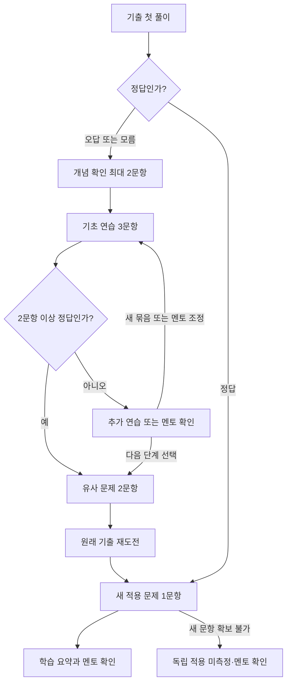

# 배움길 제품 요구사항 정의서(PRD)

- **버전**: 1.1
- **작성일**: 2026-10-24
- **상태**: 해커톤 일정에 맞춰 범위를 조정한 구현 기준안
- **대상**: 해커톤 MVP와 후속 현장 검증
- **기획서**: [배움길 프로젝트 기획서](./기획서.md)
- **개발 계획**: [해커톤 MVP 구현 순서와 작업 계획](../superpowers/plans/2026-10-24-baeumgil-hackathon-mvp.md)
- **팀 역할**: [담당 범위와 바이브 코딩 가이드](./팀역할_및_바이브코딩_가이드.md)
- **핵심 사용자**: 검정고시 학습을 지원하는 봉사 멘토
- **핵심 학습 흐름**: 기출 풀이 → 오답 개념 확인 → 필요한 기초 연습 → 유사 문제 → 원래 기출 재도전

## 1. 목적과 문서의 전제

학생의 기출 오답을 필요한 보충 학습으로 연결하고, 같은 학습 기록을 멘토의 수업 준비와 활동일지에 활용한다. 멘토가 무엇을 확인하고 설명해야 할지 결정하는 데 필요한 근거를 제공하는 것이 제품의 중심이다.

이 문서는 제품의 동작과 완료 기준을 정의한다. 개발 작업별 코드 변경 계획은 구현 소스와 실행 환경이 확인된 뒤 별도 작성한다.

### 1.1 확인된 내용과 미확인 내용

| 항목 | 현재 근거 | 문서에서의 취급 |
|---|---|---|
| 멘토 중심 제품 방향과 핵심 학습 흐름 | 팀이 확정한 기획 | 요구사항의 기준 |
| 이전 원형의 진단·퀴즈·대시보드·일지 기능 | 이전 기획서의 구현 보고 | 소스가 없으므로 새로 구현하며 구현 완료로 소개하지 않음 |
| 배움길 구현 소스 | 없음 | `apps/baeumgil/`에 신규 구현 |
| 실제 멘토링 경험 | 기획자 설명 | 기관·프로그램·업무 범위를 확인해 근거화 |
| 센터 양식 | 기획서의 제공 자료 언급, 파일 미확보 | 실물 필드와 사용 범위 확인 필요 |
| 기출 원문·정답·개념 태그 | 문항 단위 데이터 미준비 | 해커톤은 자체 제작 ‘기출 유형’ 문항으로 시작 |
| 실제 AI 호출 | 무료 등급 LLM API 사용 예정 | 기본안은 Google Gemini 무료 등급, 서버 어댑터로 교체 가능 |
| 플랫폼 | 플렉스튜디오 미사용 팀 | 자체 웹 앱으로 구현 |

### 1.2 이번 PRD에서 정한 기본값

아래 값은 기존 합의에서 정해지지 않은 동작을 구체화한 제안 기본값이다. 변경 시 요구사항·시연·검증 기준을 함께 갱신한다.

- P0는 한 브라우저에서 가상 멘토 1명·멘티 1명을 전환해 시연한다.
- 해커톤 콘텐츠는 **대표 문항 1개의 완전한 경로를 필수**로 하고, 유형 2개(각 1문항 이상)를 목표로 한다. 기출 10문제 확보는 후속 목표다.
- 기출 이용 조건을 대회 중에 확인하기 어려우므로 기본값은 자체 제작 ‘기출 유형’ 문항이다. 공식 기출을 수록하려면 이용 조건 확인 후 `official`로 표시한다.
- 우선 유형은 부호가 있는 유리수 계산과 일차방정식이다.
- AI는 무료 등급 API를 서버에서 호출한다. 무료 등급은 입력이 제공자의 서비스 개선에 쓰일 수 있으므로 가명·시연 데이터만 보낸다. 호출 한도 초과(429)는 실패로 처리한다.
- 개념 확인은 경로당 최대 2문항, 기초 연습은 한 묶음 3문항, 유사 문제는 2문항으로 시작한다.
- 기초 연습은 2/3 정답이면 다음 단계 진행을 추천한다. 1회 추가 묶음까지 제공하고, 계속 어려우면 멘토 확인을 권한다.
- 점수는 진행 추천에 사용하며 학습자의 화면 접근을 막는 조건으로 쓰지 않는다.
- 원래 기출 재도전 후 앱에 보존된 해당 학습자의 전체 노출 이력에서 처음인 적용 확인 문제 1개를 제공한다. 재도전 성공과 독립 적용을 구분하기 위한 단계다. 앱 밖의 풀이 경험까지 확인한 것으로 설명하지 않는다.
- AI 요청은 15초 안에 응답하지 않으면 실패 상태로 전환한다. 재시도는 사용자가 선택한다.
- 날짜·월별 집계 기준은 Asia/Seoul이다.

## 2. 문제와 목표

### 2.1 해결할 문제

1. 학생이 기출을 틀린 뒤 어떤 기초를 다시 배워야 할지 알기 어렵다.
2. 멘토는 오답 원인을 확인하고 보충 문제를 준비하는 일을 반복한다.
3. 학습 기록, 수업 메모, 활동 서류가 분리되어 같은 정보를 다시 정리한다.

### 2.2 MVP 목표

- 선별한 기출 한 문항에서 보충 학습과 재도전까지 끊김 없이 진행한다.
- 멘토가 각 제안의 근거 응답을 확인할 수 있다.
- 학습 결과와 관찰 메모를 활용한 일지 초안을 멘토가 검토·확정한다.
- 확정한 일지를 월별 대장과 다음 회기 준비에 활용한다.
- 실제 시간 절감과 학습 효과를 검증할 기록을 남긴다.

### 2.3 목표에 포함하지 않는 주장

- 10문제로 28개 개념의 이해도를 정확하게 확정한다는 주장
- 한 번의 오답으로 오개념이나 상위·하위 개념 전체를 확정하는 판단
- 재도전 정답만으로 숙달이나 학습 효과를 증명하는 판단
- AI가 교사·멘토의 최종 판단을 대신하는 운영
- 합격률 개선, 멘토 활동 유지, 기관 구매 의향이 이미 검증됐다는 주장

## 3. 사용자와 사용 환경

| 역할 | 주요 작업 | MVP에서 제공하는 범위 |
|---|---|---|
| 멘티 | 지정 문제 풀이, 기초·유사 문제 연습, 재도전 | 가상 프로필과 로컬 학습 화면 |
| 멘토 | 과제 지정, 근거 확인, 수업 준비, 메모·일지 확정 | 주 사용자 화면 |
| 센터 담당자 | 기록·월별 대장 확인 | 멘토 화면에서 결과 미리보기; 별도 담당자 계정은 후속 |

### 3.1 MVP 실행 환경

- 한국어 웹 화면, 노트북과 모바일 웹에서 사용한다.
- 문항은 객관식으로 한정하고, 자유 서술 풀이의 자동 채점은 제공하지 않는다.
- 한 브라우저의 로컬 저장을 사용한다. 다른 기기 간 동기화는 제공하지 않는다.
- 역할 선택은 시연용 전환이다. 인증이나 접근 권한 보장의 수단으로 설명하지 않는다.
- 실제 학생의 이름·연락처 등은 시연에 입력하지 않고 가명 데이터를 사용한다.
- 새로고침 후 마지막으로 저장된 경로와 메모를 이어서 볼 수 있어야 한다.

### 3.2 사용자 이야기

- 멘티로서 틀린 문제에서 어떤 기초를 확인해야 하는지 안내받고 싶다.
- 멘티로서 막히면 모른다고 답하거나 멘토에게 도움을 요청하고 싶다.
- 멘토로서 학생이 어떤 도움을 받고 어디까지 해결했는지 확인하고 싶다.
- 멘토로서 추천 근거를 읽고 다음 수업과 보충 문제를 선택하고 싶다.
- 멘토로서 실제 수업 결과를 수정·확정해 일지와 대장에 반영하고 싶다.

## 4. 우선순위와 범위

| 우선순위 | 의미 | 포함 기능 |
|---|---|---|
| P0 | 핵심 흐름과 해커톤 MVP 완료에 필요 | 선별 문제은행, 오답 보완 경로, 검수된 문제 생성, 학습 기록, 멘토 대시보드, 근거 기반 AI 수업 제안·일지 문장, 회기 확정·월별 합산, 로컬 저장 |
| P1 | P0 이후 보완 | 초기 적응형 진단 최대 10문제, 전체 28개 개념 지도 검토·통합, 선택형 목표 해석, 수업안 수동 편집·보관 고도화, 기록 내보내기 |
| P2 | 후속 서비스 | 일정·신청·화상 링크 고도화, 실제 인증, 서버 동기화, 담당자 권한, HWPX·PDF 출력, 다과목·다기관 확장 |

초기 진단과 목표 입력을 마쳐야 기출을 풀 수 있는 구조로 만들지 않는다. P0의 개념 지도는 두 유형의 경로에 필요한 검토된 부분 그래프부터 사용한다. 기존 전체 28개 그래프를 확보하더라도 검토되지 않은 연결을 P0의 확정 근거로 쓰지 않는다.

### 4.1 시연 완성과 MVP 완료의 구분

- **핵심 시연 통과**: 적법한 수록 범위가 확인된 기출 1문항에서 학습 경로·멘토 제안·일지 확정까지 동작한다. 사전 데이터는 시연용으로 표시한다.
- **해커톤 MVP 완료**: 핵심 시연에 더해 검수된 기출 최소 10문제, 유형 최소 2개, 13절의 P0 수용 기준과 오류 시나리오를 충족한다.
- 기출 수록 조건을 확인하지 못해 자체 제작 문항으로 시연하면 ‘기출 유형 연습 시연’으로 표시한다. 공식 기출 연동 완료나 위 기출 수량 기준 충족으로 보고하지 않는다.
- 사전 작성 AI 예시만으로 실제 AI 연동 완료를 보고하지 않는다.

### 4.2 대회 일정에 맞춘 실행 범위

| 시점 | 마감 | 반드시 보여 줄 것 |
|---|---|---|
| 예선 | 10/24(토) 19:00 PDF 제출, 20:00~22:00 3분 발표 | 대표 문항 1개의 오답→보충→재도전 화면과 실제 AI 1회 호출 결과(가능한 경우) 캡처 |
| 본선 | 10/25(일) 09:00 진출 발표 후, 발표 5분·질의응답 5분 | 학습 경로 → 멘토 대시보드 → 실제 AI 수업 제안 → 일지 확정 → 월별 대장을 한 번에 시연 |

본선 PPT 가이드가 시스템 구조도와 API 활용 방법을 요구하므로 기획서 8절의 구조도를 발표 자료에 사용한다.

**본선까지 구현할 P0(해커톤 필수)**: FR-01~06, FR-07의 회기 입력·초안·확정·개정, FR-08, FR-09의 저장·새로고침 복원·저장 실패 표시.

**P0 후속(대회 이후)**으로 미루는 항목:

- 다중 탭 충돌 감지, 손상 데이터 복구·다운로드 (FR-09)
- 확정 일지 철회 (FR-07)
- 오채점 정정(`CORRECT_ATTEMPT`)과 도움 기록의 멘토 보정 이력 (FR-02, 9절)
- 공식 기출 10문제 수록과 이용 조건 검수 (AC-18)
- 센터 실물 양식 매핑 (양식 파일을 받지 못한 경우)

후속 항목도 요구사항에서 삭제하지 않는다. 시연에서 구현된 것처럼 설명하지 않고 ‘후속 구현’으로 표시한다.

## 5. 전체 사용자 흐름과 화면

### 5.1 주 사용자 흐름

1. 멘토가 학생과 회기를 선택하고 지원하는 기출을 지정한다.
2. 멘티 화면에서 문항 출처·시간 기록 안내를 확인하고 풀이한다.
3. 오답 또는 ‘잘 모르겠어요’ 응답이면 개념 확인과 보충 경로를 안내한다.
4. 기초 연습과 유사 문제를 거쳐 원래 기출에 재도전한다.
5. 앱에 보존된 해당 학생의 전체 노출 이력에서 새로운 적용 확인 문제를 풀고 학습 요약을 확인한다.
6. 멘토는 단계별 응답·도움 사용과 AI 수업 제안을 확인한다.
7. 실제 수업 후 출석·시간·관찰 메모를 입력하고 활동일지를 검토·확정한다.
8. 확정본을 월별 대장과 다음 회기 화면에서 확인한다.

### 5.2 화면 목록

| ID | 화면 | 반드시 보여 줄 정보와 행동 |
|---|---|---|
| S01 | 시작·역할 선택 | 시연 안내, 멘토/멘티 전환, 가상 프로필, 이어 하기 |
| S02 | 멘토 홈·학생 상세 | 최근 경로, 미완료 학습, 회기 선택, 문제 지정 |
| S03 | 문제은행 | 유형·출처 필터, 기출/자체 제작 구분, 지원 여부, 지정/시작 |
| S04 | 학습 실행 | 현재 단계, 문제·선택지, 답 제출, 모름, 힌트, 중단·이어 하기 |
| S05 | 결과·배움길 | 단계별 결과, 직접 확인/추정 구분, 추천 이유, 도움 요청 |
| S06 | 수업 준비 | 근거 타임라인, AI 제안, 불확실성, 근거 응답 열기 |
| S07 | 회기·활동일지 | 실제 출석·시간, 관찰 메모, 사실 요약, AI 초안, 수정·확정 |
| S08 | 월별 대장 | 해당 월 확정 회기, 활동 시간 합계, 최신 유효본, 복사 |

모바일에서 문항과 주요 버튼이 가로 스크롤 없이 보여야 한다. 긴 대장은 가로 스크롤 또는 행 상세 보기로 제공할 수 있다.

## 6. 기능 요구사항

### FR-01. 문제은행과 과제 지정 — P0

- 기출에는 연도·회차·학교급·과목·문항 번호·원문 출처·정답·연결 개념·검수 상태를 저장한다.
- 자체 제작 문항에는 원 기출 인용처럼 보이는 메타데이터를 부여하지 않는다. 참조 유형과 자체 제작 표시를 제공한다.
- 이용 범위 및 내용 검수가 승인된 문항만 앱 안에서 출제한다.
- 보충 경로가 준비된 문항을 ‘오답 보완 지원’으로 표시한다. 경로가 없는 문항은 P0 출제 목록에서 제외한다.
- 멘토는 학생에게 문항을 지정하고, 학생은 해당 지정 항목에서 시작한다. 한 문항을 다시 지정해도 이전 응답을 덮어쓰지 않는다.
- P0에서 멘티의 자유 선택 범위는 멘토가 지정한 문항과 검수된 공개 연습 목록이다.

### FR-02. 응답·채점·도움 기록 — P0

- 제출 전에는 답을 변경할 수 있다. 제출 후에는 원래 응답을 보존하고 다음 시도를 새 기록으로 만든다.
- 채점은 정답 데이터와 코드로 처리한다. AI가 정답 여부를 판정하지 않는다.
- 무응답 제출은 차단하고, ‘잘 모르겠어요’는 `abstained`로 기록한다. 정답·오답과 별도로 집계한다.
- 힌트 열람, 해설·정답 노출, 멘토 도움 여부를 시도별로 기록한다.
- 풀이 시간은 화면이 활성화된 동안 누적한다. 숨김·명시적 중단 시 멈추고 새로고침 뒤 저장값에서 이어 간다. 해당 시간은 참고용이다.
- 도움 여부는 학생이 표시할 수 있고 멘토가 나중에 보정할 수 있다. 보정 전 값과 변경 시점을 남긴다.
- 중복 클릭·재전송으로 동일 시도가 두 번 저장되지 않도록 처리한다.

### FR-03. 오답 보완 경로 — P0

- 상태와 분기는 7절에 따른다.
- 원 문항에는 핵심 개념·선수 개념·확인 문항·기초 문항 틀·유사 문항 틀·새 적용 문항의 연결을 사전 검수한다.
- 개념 확인 문항 선택 순서는 검수한 연결 순서로 결정한다. AI가 실행 중 임의의 새 개념을 진단 결과에 추가하지 않는다.
- 개념 확인 최대 2문항 중 오답·모름이 나온 첫 개념을 우선 연습 후보로 제안한다. 이는 학습 순서 규칙이며 오개념의 확정 진단이 아니다.
- 확인 문항을 모두 맞혔으면 원 기출의 핵심 개념 연습을 제안한다. ‘기초를 모두 안다’고 표시하지 않는다.
- 연습은 3문항 중 2문항 정답이면 다음 단계 진행을 추천한다. 미달이면 새 3문항 묶음을 한 번 더 제안한다.
- 두 묶음 후에도 미달이면 ‘멘토와 함께 확인해요’를 표시한다. 더 어려운 문제만 자동으로 반복하지 않는다.
- 멘토는 개념·단계를 조정할 수 있고 이유를 기록한다. 멘티도 다음 단계 진행이나 중단을 선택할 수 있으며, 추천을 건너뛴 사실을 남긴다.
- 기존 기출·유사 문제의 정답 노출은 별도로 기록한다. 동일 원문 재도전의 정답을 독립 숙달로 집계하지 않는다.

### FR-04. 검수된 유사·기초 문제 생성 — P0

- P0는 승인된 문항 틀과 허용 매개변수 범위에서 생성한다.
- 유형별 기초 연습, 유사 문제, 새 적용 문제에 필요한 문항 틀을 준비한다. 하나의 틀을 재사용하려면 각 용도에 적합하다는 검토를 남긴다.
- 정답 유일성, 선택지 중복, 분모 0 등 금지 조건, 문제·해설·정답의 일치를 검사한다.
- 수학적으로 같은 선택지는 같은 값으로 비교한다. 표시만 다른 동치 분수 등을 중복 정답으로 만들지 않는다.
- 새 적용 문제는 앱에 보존된 해당 학습자의 전체 노출 이력과 비교한다. 이전 경로에서 본 문제·정답을 본 문제도 제외한다. ID만 바꾸거나 선택지 순서만 바꾼 같은 문제를 새 문항으로 취급하지 않는다. 문항 내용·조건·선택지의 동일 인스턴스를 알아볼 수 있는 노출 식별값을 사용한다.
- 학습자 화면에 문항 본문이 처음 표시될 때 노출 기록을 저장한다. 답을 제출하지 않고 중단해도 노출 사실을 보존한다. 현재 표시를 추가하기 전에 신규 여부를 판정해 해당 시도에 저장한다.
- 이력 손상 등으로 과거 노출을 확인할 수 없으면 새 문항 여부를 `unknown`으로 기록하고 독립 적용 지표에서 제외한다. 기록이 초기화된 시연의 결과는 초기화 후 앱 기록 범위에 한정한다.
- 숫자만 바뀐 유사 문제도 난이도 동등성이 검증된 것으로 표현하지 않는다.
- 최대 20회 생성해도 유효 문항을 만들지 못하면 검수된 고정 예비 문항으로 대체한다. 새 적용 단계의 예비 문항에도 전체 노출 이력 검사를 적용한다. 유효한 새 적용 문항을 확보하지 못하면 `not_measured`와 이유를 기록하고 `needs_mentor` 요약으로 이동한다. 다른 단계도 예비 문항이 없으면 진행 불가를 알리고 멘토 확인으로 종료할 수 있게 한다.
- 생성 문항은 원 기출 ID, 문항 틀 버전, 매개변수, 생성 식별자를 남겨 재현할 수 있어야 한다.

### FR-05. 학습 요약과 개념 근거 — P0

- 최초 응답, 개념 확인, 기초 연습, 유사 문제, 기출 재도전, 새 적용 문제를 구분해 표시한다.
- 개념 근거는 `observed`(직접 응답), `inferred`(관계상 추정), `needs_review`(근거 부족·상충)로 구분한다.
- 직접 확인된 정답·오답은 해당 시도의 사실이다. 개념의 영구 숙달 상태로 전환하지 않는다.
- 선수 관계만으로 연결된 다른 개념을 일괄 확정하지 않는다.
- 단정적인 ‘찍음’, ‘과신’, ‘의지 부족’ 대신 관찰 사실과 확인할 질문을 보여 준다.
- 불완전 경로·중단·단계 건너뛰기를 완료 경로와 구분한다.

### FR-06. 근거 기반 AI 수업 제안 — P0

- 멘토가 요청하면 선택한 학생의 최신 경로·회기 기록에서 입력 스냅샷을 만든다.
- 출력은 추천 개념, 근거 ID, 확인할 오개념 후보, 설명 방법, 사용할 승인 문항 ID, 불확실성·추가 질문으로 구성한다.
- 출력의 개념·문항·근거 ID가 입력·승인 목록 안에 있는지 검사한다. 없는 ID나 필수 필드 누락 시 결과를 채택하지 않는다.
- 응답이 적거나 상충하면 추가 확인을 제안하고 확정 진단을 피한다.
- 응답 후 근거를 눌러 실제 문항 응답과 메모를 열 수 있어야 한다.
- 제안은 자동 과제 배정·평가 변경으로 실행되지 않는다. 멘토가 채택·수정·미채택을 선택하고 이유를 남길 수 있다.
- 학습 데이터가 바뀌면 기존 제안을 ‘이전 기록 기준’으로 표시한다. 늦게 도착한 이전 요청이 최신 결과를 덮어쓰지 않아야 한다.

### FR-07. 실제 회기 기록과 활동일지 — P0

- 학생의 자율 학습 경로와 실제 멘토링 회기를 별도 객체로 관리한다. 퀴즈 완료만으로 출석·활동 시간을 생성하지 않는다.
- 멘토는 회기 날짜, 출석 상태, 실제 활동 시간, 연결 학습 경로, 관찰 메모를 입력한다.
- 사실 요약과 수치 집계는 코드로 만들고, AI는 해당 사실과 메모를 바탕으로 서술 초안을 작성한다.
- 관찰 메모가 없으면 참여 태도·감정·자신감·관계 변화에 관한 문장을 만들도록 요청하지 않는다.
- AI 초안은 필수 근거 참조를 포함해야 하며, 멘토가 원자료와 비교해 수정·확정한다. 구조 검사가 문장 내용의 진실성을 보장한다고 설명하지 않는다.
- 초안과 확정본을 구분한다. 확정하려면 `attended` 출석, 양의 정수 활동 시간(분), 작성 내용 검토 확인이 필요하다. 결석·취소는 별도 기록으로 남기고 활동 시간에 합산하지 않는다.
- 확정 후 수정은 새 개정본을 만든다. 이전 확정본은 보존하고 최신 유효 개정본 하나만 집계한다.
- 멘토는 확정본을 이유와 함께 철회할 수 있다. 철회 이력을 보존하고 해당 회기는 유효한 재확정본이 생기기 전까지 합산에서 제외한다.
- 센터 실물 양식 확인 전에는 ‘제공받은 양식 일치 검수 전’으로 표시한다. 필드 매핑이 검토된 뒤에만 센터 양식 지원 완료로 보고한다.

### FR-08. 월별 대장과 복사 — P0

- 회기 날짜의 한국 시간 월을 기준으로 최신 유효 확정 일지를 모은다.
- 초안·결석·취소·철회된 기록을 활동 시간과 회기 수에서 제외한다.
- 같은 회기 확정을 반복하거나 개정해도 회기 수와 시간이 중복 합산되지 않는다.
- 대장에 회기별 날짜·멘티·활동 시간·내용·일지 참조를 제공한다.
- 텍스트·표 복사를 제공한다. 클립보드 사용 실패 시 선택 가능한 텍스트를 제공한다.
- HWPX·PDF 파일 생성이나 공식 제출 완료 기능으로 설명하지 않는다.

### FR-09. 로컬 저장과 시연 초기화 — P0

- 시도 제출, 단계 이동, 메모 변경, 일지 확정 시 저장한다. 메모는 수정 후 1초 이내 자동 저장을 목표로 하고 저장 상태를 표시한다.
- 저장 형식에 스키마 버전을 둔다. 읽을 수 없는 버전을 조용히 덮어쓰지 않는다.
- 저장 공간 부족·접근 실패 시 ‘이 브라우저에 저장하지 못했어요’를 표시하고 현재 화면의 내용을 유지한다. 성공으로 표시하지 않는다.
- 손상 데이터가 있으면 복구 가능한 읽기·다운로드를 안내하고 사용자 선택 없이 초기화하지 않는다.
- 시연 데이터 초기화는 로컬에 저장된 데이터가 지워짐을 알리고 사용자의 명시적 선택 뒤 실행한다.
- P0는 단일 활성 탭을 기준으로 한다. 다른 탭의 변경을 감지하면 현재 탭의 쓰기를 멈추고 최신 기록을 다시 읽도록 안내한다.

### FR-10. 선택형 목표와 초기 진단 — P1

- 진로 미정·검정고시 합격 목표로 시작할 수 있고 목표 입력을 건너뛰어도 P0 학습이 가능하다.
- 초기 진단은 최대 10문제로 수업 시작점 후보를 정리한다. 불확실한 개념은 미확인으로 남긴다.
- 28개 개념의 실제 목록·선수 관계는 기존 자료 확보와 검토 후 통합한다.
- 진로 목표는 동기 설명에 사용한다. 자격·진학 요건은 공식 정보 확인이 필요한 참고안으로 표시한다.

## 7. 학습 경로 상태와 분기

| 상태 | 진입 조건 | 다음 행동·종료 |
|---|---|---|
| `original_attempt` | 지정 문항에서 시작 | 정답이면 `transfer_check`, 오답·모름이면 `concept_check` |
| `concept_check` | 최초 오답·모름 | 최대 2문항 후 검수 규칙으로 연습 후보 결정 |
| `foundation_practice` | 확인 결과 또는 멘토 선택 | 3문항 묶음 최대 2회; 추천 여부와 별개로 다음 단계·중단 선택 가능 |
| `similar_practice` | 기초 연습 뒤 진행 | 2문항 결과를 기록하고 기출 재도전 제안; 부진 시 멘토 확인 표시 |
| `original_retry` | 유사 문제 뒤 진행 | 같은 원 문항에 경로당 1회 재도전하고 `transfer_check`로 이동 |
| `transfer_check` | 최초 정답 또는 재도전 뒤 | 앱의 해당 학생 전체 노출 이력에서 새 문항 1개 후 요약; 확보 불가 시 미측정·멘토 확인 |
| `completed` | 필수 분기를 모두 진행 | 결과 요약; 숙달 확정은 하지 않음 |
| `needs_mentor` | 어려움 지속, 지원 요청, 필수 문항 부재 | 기록을 보존하고 멘토에게 확인 필요 표시 |
| `paused` | 명시적 중단 | 마지막 저장 단계에서 재개 |

보충 학습을 건너뛰면 완료 여부와 별개로 `skippedStageIds`와 `needsReview=true`를 남긴다. 미완료 경로를 성공 경로 통계에 섞지 않는다. `needs_mentor`에서 멘토가 재개 단계를 정할 수 있고 이력을 남긴다. 같은 기출을 처음부터 다시 연습하면 새 경로를 만든다.

## 8. 콘텐츠와 개념 지도 요구사항

### 8.1 문항 검수 항목

- 기출 원문·공식 정답·표기·도형이 일치하는가?
- 수록·변형·제공 범위와 출처 표기가 확인되었는가?
- 핵심 개념과 선수 개념 연결이 교육적으로 설명 가능한가?
- 개념 확인 문항과 기초·유사·새 적용 문항이 준비되었는가?
- 정답이 유일하고 해설이 정답과 일치하는가?
- 문제 조건이나 숫자 변경으로 원치 않는 계산·난이도 변화가 생기지 않는가?

### 8.2 콘텐츠 상태

- `pending`: 자료·이용 범위·내용 중 확인되지 않은 항목이 있음. 학습자에게 출제하지 않음.
- `link_only`: 원문 링크만 안내할 수 있는 상태. 앱 안에 원문을 수록하거나 응답 경로에 사용하지 않음.
- `approved`: 서비스에서 사용할 범위와 내용 검토가 완료됨. 검토자·검토일·버전을 남김.
- `retired`: 오류 등으로 사용 중단. 새 출제에서 제외하되 기존 응답의 스냅샷은 보존.

콘텐츠 검수는 P0에서 데이터 파일·검수 목록으로 관리할 수 있다. 별도 관리자 화면은 필수가 아니다.

### 8.3 선수 관계

- 관계에 출발·도착 개념 ID, 검토 근거, 버전을 남긴다.
- 존재하지 않는 개념 참조와 순환 관계를 감지한다. 오류가 있는 연결을 추천 계산에 사용하지 않는다.
- 관계는 추천 순서를 정하는 근거이며 정답·오답을 다른 개념 전체로 확정 전파하는 규칙이 아니다.

## 9. 데이터 요구사항

저장 방식과 내부 코드 구조는 구현자가 정할 수 있다. 다음 정보와 연결은 유지해야 한다.

| 데이터 | 필수 정보와 관계 |
|---|---|
| `Learner` | ID, 가명, 학교급, 선택 목표; 시연 여부 |
| `Mentor` | ID, 표시 이름; P0 가상 프로필 |
| `Concept` | ID, 이름, 설명, 선수 관계, 검수 버전 |
| `Question` | ID, 종류(기출/자체 제작), 출처 메타데이터, 문항·선택지·정답 스냅샷, 개념 ID, 콘텐츠 상태·버전 |
| `QuestionTemplate` | ID·버전, 용도, 개념 ID, 매개변수 범위, 정답·검사 규칙, 검수 정보 |
| `Assignment` | ID, 학생·멘토·문항 ID, 지정 시각, 상태 |
| `LearningPath` | ID, 학생·과제·원 문항 ID, 현재 단계, 연습 묶음 수, 상태, 단계 건너뛰기, 검수 규칙 버전 |
| `Attempt` | ID, 경로·단계·문항 인스턴스 ID, 답, 결과(correct/incorrect/abstained), 활성 풀이 시간, 힌트·해설·도움 기록, 시각 |
| `QuestionExposure` | 학생·문항 인스턴스 ID, 노출 식별값, 최초 노출 시각·경로·단계, 정답 노출 여부; 시도에 표시 전 신규 여부(first_seen/already_seen/unknown) 연결 |
| `Evidence` | ID, 개념 ID, 근거 유형, 연결 시도·메모 ID, 관찰 내용, 생성 규칙 버전 |
| `MentoringSession` | ID, 학생·멘토 ID, 현지 날짜, 출석(attended/absent/canceled/not_recorded), 실제 활동 분, 연결 경로 ID, 관찰 메모·변경 이력 |
| `AIArtifact` | ID, 종류(수업안/일지 문장), 입력 스냅샷·근거 ID, 요청 ID, 응답·오류 상태, 모델·프롬프트 버전, 채택 상태 |
| `ActivityLog` | 회기 ID, 개정 번호, 사실 요약, AI 초안, 멘토 수정본, 확정 상태·시각, 대체한 개정본 ID |

- 문항의 후속 수정이 과거 응답의 채점 결과를 조용히 바꾸지 않도록 당시 버전과 스냅샷을 보존한다.
- 오채점이 발견되면 원 기록과 정정 기록·이유를 함께 보존하고 대시보드와 연결 일지에 재검토 필요를 표시한다.
- 월별 대장은 최신 유효 확정 일지에서 계산하는 조회 결과로 취급한다.
- 최초 정답률, 재도전 정답률, 새 적용 문제 정답률을 섞지 않는다. 정답률 분모는 정답·오답 응답이며 모름·미완료는 별도 수치로 표시한다.
- 새 적용 성과의 집계에는 표시 전 신규 여부가 `first_seen`인 시도만 사용한다. 새 문항 확보 실패(`not_measured`)와 노출 이력 불명(`unknown`)은 해당 지표 분모에서 제외하고 건수를 따로 보여 준다.

## 10. AI와 규칙 엔진의 책임

| 처리 | 책임 주체 |
|---|---|
| 채점·문항 수치 생성·정답 계산·기본 조건 검사 | 코드와 검수된 콘텐츠 |
| 학습 단계·개념 후보 선택·집계 | 버전이 있는 검수 규칙과 코드 |
| 관찰 사실의 수치 요약 | 코드 |
| 설명 방법·확인 질문·활동일지 서술 초안 | AI |
| 문항·개념 관계의 교육적 적절성 | 콘텐츠 검수자 |
| 수업 방향·관찰 내용·최종 활동일지 | 멘토 |

### 10.1 AI 입력·출력 원칙

- AI에는 필요한 가명 학습 기록과 해당 회기 메모만 전달한다.
- 입력 메모와 문항은 자료로 취급한다. 그 안의 문구가 시스템 지침을 바꾸도록 하지 않는다.
- 사용 가능한 근거·개념·문항 ID 목록을 전달하고 출력 참조를 검증한다.
- AI 제안의 문장에는 근거를 연결하고 가능성과 확인된 사실을 구분한다.
- AI가 생성한 답을 채점용 정답으로 사용하지 않는다.
- 실제 호출, 사전 작성 예시, 규칙 기반 대체를 명확히 표시한다.
- 비밀 API 키를 브라우저 소스에 넣지 않는다. 무료 API 키는 로컬 서버의 환경 변수에서만 읽고 `/api/ai`로 경유한다. 키 파일은 공유 저장소에 올리지 않는다.

### 10.2 AI 실패 처리

- 요청 중 상태와 취소·기다림 종료를 제공한다.
- 15초 초과, 통신 실패, 무료 등급 호출 한도 초과, 잘못된 출력 구조·참조는 실패로 처리한다.
- 기존 학생 응답과 메모는 보존하고 수동 재시도를 제공한다.
- 수업 준비는 규칙 기반 사실 요약을 보여 주고 멘토가 직접 작성할 수 있게 한다.
- 활동일지는 사실 요약과 멘토 입력으로 계속 작성·확정할 수 있게 한다.
- 실패를 실제 AI 결과처럼 꾸민 예시로 자동 대체하지 않는다.
- 실패가 있어도 채점·학습 경로·기존 기록 조회가 중단되지 않아야 한다.

## 11. 비기능 요구사항

### 11.1 사용성과 접근성

- 한국어 문장과 단계 이름을 사용하고 개발 용어를 학생 화면에 노출하지 않는다.
- ‘모름’·중단·도움 요청을 정답 제출과 함께 찾을 수 있게 한다.
- 키보드로 문항·선택지·주요 버튼을 조작할 수 있게 하고 초점 표시를 제공한다.
- 결과를 색상만으로 구분하지 않고 텍스트·기호를 함께 사용한다.
- 멘티에게 멘토의 미확정 관찰 메모나 일지 초안을 보여 주지 않는다. P0의 역할 전환은 보안 장벽이 아님을 시연 안내에 명시한다.

### 11.2 반응성과 복구

- 기준 콘텐츠 규모에서 로컬 채점과 다음 단계 표시는 목표 1초 이내다.
- 메모의 저장 중·저장됨·실패 상태를 구분한다.
- 새로고침, AI 실패, 저장 실패가 기존 확정 기록을 삭제하지 않아야 한다.
- 앱 로컬 자원이 로드된 후 AI 통신이 끊겨도 규칙 기반 학습과 수동 일지 작성은 가능해야 한다. 최초 오프라인 설치·캐시는 P0 범위가 아니다.

### 11.3 데이터 취급

- 해커톤에는 가명·시연 데이터만 사용한다.
- 학습 시간은 참고 정보이며 몰래 수집하는 동작으로 설계하지 않는다.
- 실제 기관 운영 전 인증·권한·공동 저장·보관 및 삭제 절차를 별도 설계한다.

## 12. 계측과 효과 검증

### 12.1 제품 내 기록

- 학습 경로 시작·중단·단계 이동·완료·멘토 확인 요청
- 단계별 응답·힌트·해설·도움 사용
- 문항 생성 실패와 예비 문항 사용
- AI 요청 성공·실패·재시도·채택·수정·미채택
- 일지 초안 작성·수정·확정·개정
- 저장 실패와 복구 선택

P0는 로컬 기록으로 확인한다. 외부 분석 서비스 도입을 전제로 하지 않는다.

### 12.2 현장 검증

| 지표 | 측정 정의 | 해석 제한 |
|---|---|---|
| 수업·문제 준비 시간 | 같은 학생 자료로 준비 시작부터 사용할 자료 확정까지 비교 | AI 대기와 수정 시간 포함 |
| 일지 작성 시간 | 같은 회기 자료로 작성 시작부터 확정까지 비교 | 검토 시간 포함; 화면 체류 시간만으로 대체하지 않음 |
| AI 제안 유용성 | 채택·수정·미채택과 이유 | 채택률만으로 교육 효과를 주장하지 않음 |
| 독립 적용 | 앱의 해당 학생 전체 노출 이력에서 새 문항을 힌트·해설·도움 없이 맞힌 시도 | 동일 기출 재도전과 구분; 앱 밖의 노출·장기 숙달로 일반화하지 않음; 미측정·노출 불명은 제외 |
| 초안 사실 오류 | 근거 없는 내용과 수치·관찰 불일치 검토 | 표본과 검토자를 함께 기록 |
| 반복 사용 | 다음 회기 사용과 중단 사유 | 소규모 결과를 전체 센터 수요로 환산하지 않음 |

수치 개선 목표는 베이스라인 조사 후 정한다. 초기 PRD에서 임의의 절감률·합격률을 성공 실적으로 제시하지 않는다.

## 13. 수용 기준과 완료 조건

### 13.1 P0 수용 기준

| ID | 검증 시나리오 | 통과 조건 |
|---|---|---|
| AC-01 | 기출 최초 오답 | 개념 확인→기초→유사→원 기출 재도전→새 적용→요약으로 이동하고 원 응답 보존 |
| AC-02 | 기출 최초 정답 | 불필요한 보충 단계를 강제하지 않고 새 적용 문제로 이동 |
| AC-03 | 모름·무응답 | 모름은 별도 저장하고 보충 경로 제공; 무응답 제출은 차단 |
| AC-04 | 기초 연습 반복 미달 | 최대 두 묶음 후 멘토 확인 제안; 무한 반복·접근 차단 없음 |
| AC-05 | 추천 단계 건너뛰기 | 진행 가능하고 건너뛴 단계·검토 필요 상태가 요약에 남음 |
| AC-06 | 유사·새 적용 문제 생성 | 승인 틀·유효 조건·정답 유일성 충족; 새 적용은 전체 학생 노출 이력과 비교; 이전 경로의 노출·미제출 노출도 제외; 새 문제 확보 실패는 미측정·멘토 확인 |
| AC-07 | 도움·정답 노출 후 정답 | 독립 적용과 구분; 같은 기출 재도전을 숙달로 표시하지 않음 |
| AC-08 | 개념 추정 | 직접 응답과 추정을 구분하고 한 오답으로 관련 개념 전체를 확정하지 않음 |
| AC-09 | AI 수업 제안 | 실제 연결된 근거를 열 수 있고 존재하지 않는 참조를 채택하지 않음 |
| AC-10 | AI 시간 초과·이전 응답 도착 | 실패·재시도와 수동 대체 제공; 이전 응답이 최신 상태를 덮어쓰지 않음 |
| AC-11 | 자율 학습 완료 | 멘토링 출석·시간·확정 일지가 자동 생성되지 않음 |
| AC-12 | 일지 초안과 확정 | 실제 회기 정보·멘토 검토 후에만 확정; 초안은 월별 합산 제외 |
| AC-13 | 확정 중복·개정·철회 | 최신 유효본 하나만 집계; 원본 이력 유지 |
| AC-14 | 월 경계 회기 | 한국 시간의 회기 날짜로 해당 월에 한 번 집계 |
| AC-15 | 새로고침·저장 실패·다른 탭 | 저장된 단계 복원, 실패 안내, 충돌 시 쓰기 중단; 조용한 삭제·덮어쓰기 없음 |
| AC-16 | 시연 초기화 | 명시적 선택 전 기존 로컬 기록을 지우지 않음 |
| AC-17 | 콘텐츠 상태·출처 | 승인 문항만 출제하고 기출·자체 제작·원문 링크 구분 |
| AC-18 | 최소 콘텐츠 | 검수된 기출 10문제·2유형과 각 경로용 문항 틀·예비 문항 준비 |
| AC-19 | 실제 AI 시연 | 연결된 학생 기록으로 수업 제안과 일지 문장을 실제 생성; 사전 예시는 별도 표시 |
| AC-20 | 양식·모바일·키보드 | 실제 양식 매핑 검수, 모바일 주요 흐름 및 키보드 조작 확인 |

**본선 전 필수 확인**: AC-01~12, AC-14, AC-16, AC-17, AC-19. AC-13은 확정·개정까지, AC-15는 새로고침 복원·저장 실패 안내까지 확인한다. AC-18은 ‘대표 경로 1개 + 유형 2개’ 기준으로 확인하고, 공식 기출 10문제 기준은 후속이다. AC-20은 모바일·키보드만 확인하고 양식 매핑은 파일 확보 시 진행한다.

### 13.2 완료 보고 기준

- AC-01~AC-20을 실제 실행 환경에서 확인하고 결과를 남긴다.
- 실제 구현 여부, 시연용 데이터, 실패 시 대체를 구분해 보고한다.
- 미충족 항목이 있으면 ‘MVP 완료’로 표시하지 않고 핵심 시연 통과 범위와 남은 항목을 명시한다.
- 이 PRD 파일의 작성 완료는 제품 구현이나 위 검증 완료를 뜻하지 않는다.

## 14. 시연 시나리오

1. 실제로 확인한 멘토 업무와 서비스가 줄이려는 준비·기록 부담을 설명한다.
2. 시연용 학생에게 지정한 기출 1문항을 풀고 오답을 남긴다.
3. 개념 확인과 기초 연습을 진행하고, 유사 문제로 적용한다.
4. 원래 기출에 재도전한 뒤 앱의 해당 학생 전체 노출 이력에서 새 적용 문제를 풀어 결과를 구분한다.
5. 멘토 화면에서 단계별 근거와 실제 AI 수업 제안을 확인한다.
6. 시연용 회기의 관찰 메모를 넣고 실제 AI 일지 초안을 검토·수정·확정한다.
7. 월별 대장과 다음 회기 화면에서 같은 기록이 이어짐을 확인한다.

사전 데이터와 생략한 단계는 시연용임을 표시한다. 실제 멘토링 성과, 공식 제출, 기관 도입이 완료된 것처럼 설명하지 않는다.

## 15. 위험, 선행 조건과 현장 확인 항목

| 항목 | 현재 상태 | 확인·대응 | 막히는 범위 |
|---|---|---|---|
| 무료 AI API | 키 발급·호출 미확인 | 착수 직후 1회 호출 확인; 한도 초과 대비 사전 녹화 또는 규칙 기반 대체를 시연 예비로 준비(실제 결과처럼 표시하지 않음) | 실제 AI 시연(AC-19) |
| 대회 일정 | 예선 PDF 19:00, 본선 발표 5분 | 4.2절의 단계별 범위를 지키고 후속 항목을 늘리지 않음 | 본선 시연 완성 |
| 기출 원문·공식 정답·이용 범위 | 문항별 미검토 | 선별 목록과 검수 기록 준비; 필요 시 자체 제작 시연 명시 | 공식 기출 수록과 AC-18 |
| 개념 목록·선수 관계 | 기존 기획상 28개, 실물 미확인 | 두 유형의 부분 그래프부터 검토 | 미검토 개념 자동 추천 |
| 센터 양식 | 실물 필드 미확인 | 양식·작성 예시·필수 필드 매핑 확인 | 센터 양식 지원 완료 판정 |
| 멘토의 실제 활동기관·업무 | 사용자 설명과 별도 꿈여울 공고 존재 | 프로그램을 구분하고 확인된 경험만 발표에 사용 | 현장 근거 문구 확정 |
| 오답 원인 추정 | 교육적 가설 | 추가 문항·멘토 판단과 비교 | 진단 정확성 주장 |
| AI 설명·일지의 근거 일치 | 미검증 | 구조·참조 검사와 멘토 검토, 실패 시 수동 작성 | 자동 확정 금지 |
| 실제 학생·기관 도입 | 후속 | 인증·권한·공동 저장과 기관 운영 조건 검토 | 실사용 운영 |

문서 작성과 가명 데이터 기반 구현 설계는 진행할 수 있다. 위 자료가 없어도 완료된 것처럼 표시하거나 미검토 데이터를 공식 자료로 대체하지 않는다.

## 16. 후속 확장

1. 꿈드림 등 검정고시 학습 멘토링 현장에서 반복 사용과 업무 효과 확인
2. 성인 검정고시 지원기관·야학에서 같은 콘텐츠와 운영 흐름의 적용 가능성 검증
3. 성인문해교육기관의 별도 교육과정·평가·양식 검토
4. 노인복지관 등의 문해·디지털 학습 프로그램에서 접근성·실습 평가 검증

교육자 중심 구조의 재사용 가능성과 실제 기관의 구매 의향은 별개로 확인한다. 성인 전체가 소프트웨어를 활용하기 어렵다는 전제를 사용하지 않는다.

## 17. 변경 관리

- 요구사항 변경은 버전·날짜·변경 이유와 영향을 받는 FR/AC를 남긴다.
- 학습 규칙·문항·템플릿·개념 그래프·AI 프롬프트의 버전을 구분해 과거 기록을 재현할 수 있게 한다.
- 구현 단계에서 PRD와 충돌하는 기존 동작을 발견하면 원 기획의 구현 보고보다 이 문서의 합의된 요구사항을 기준으로 변경안을 검토한다.

| 버전 | 날짜 | 내용 |
|---|---|---|
| 1.0 | 2026-10-24 | 기출 연계 보충 학습, 멘토 수업 준비·기록, 범위·예외·수용 기준 최초 작성 |
| 1.1 | 2026-10-24 | 대회 일정(4.2) 반영, 일부 P0를 후속으로 이동, 자체 제작 문항 기본값, 무료 AI API 기본안, 신규 구현 확정. 영향: FR-02·07·09, AC-13·15·18·20 |
